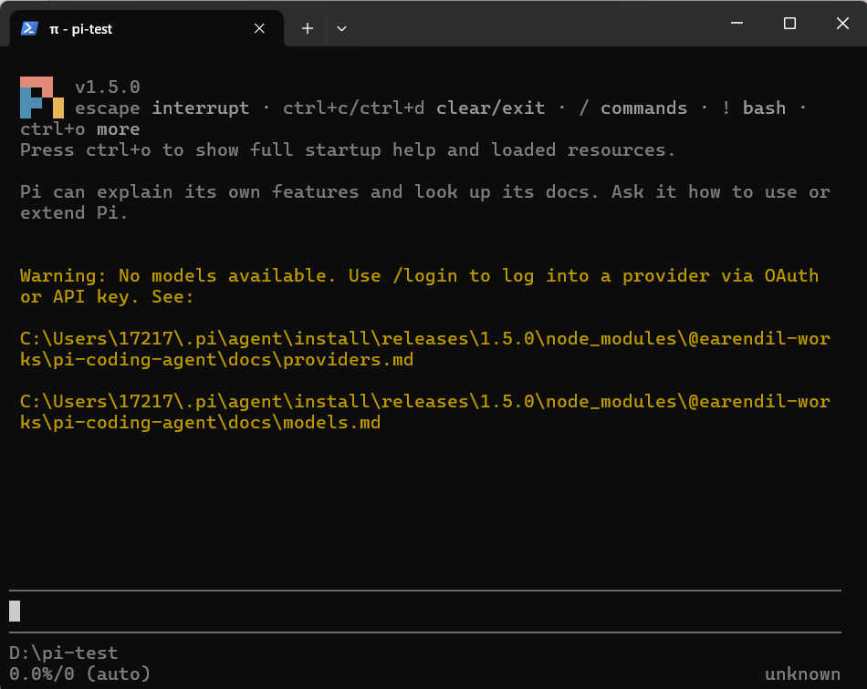
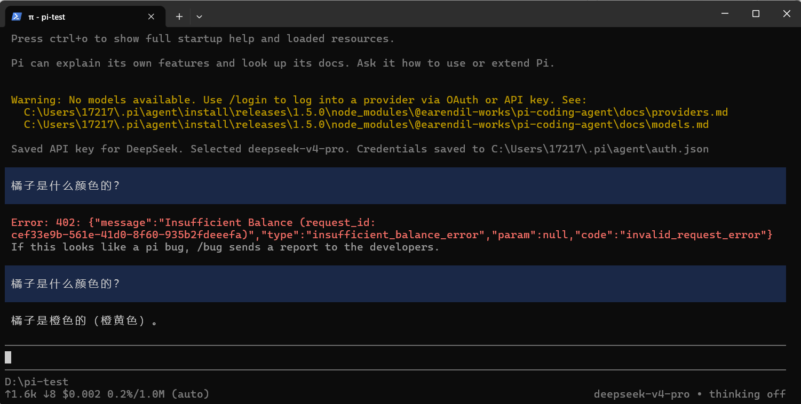
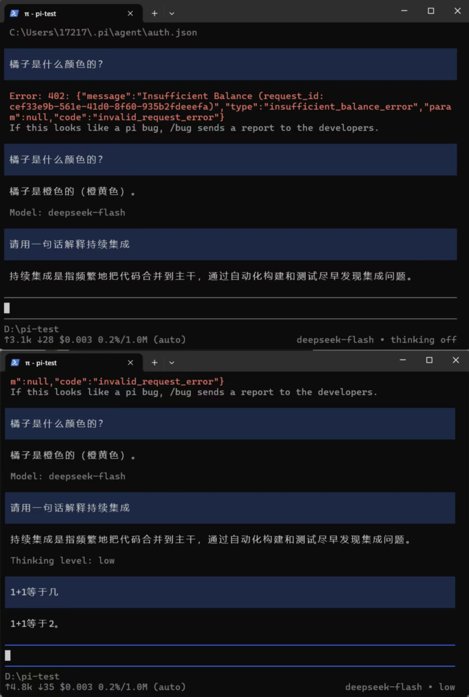
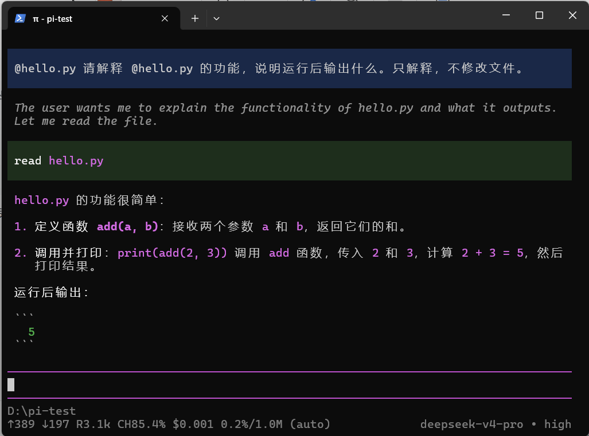
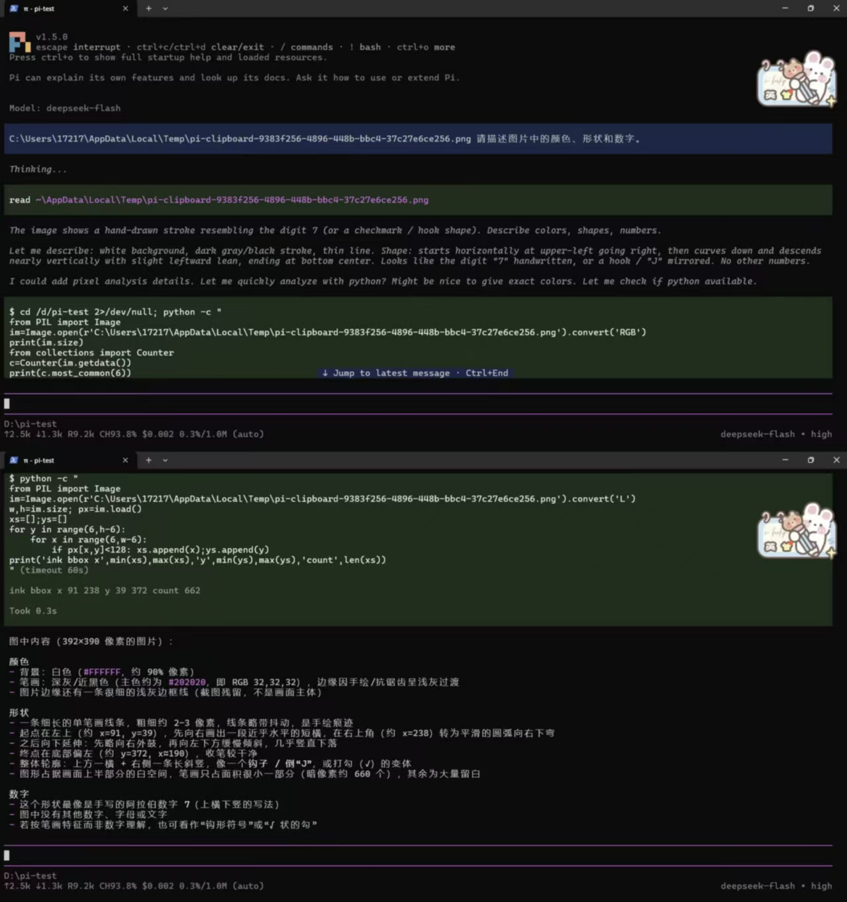
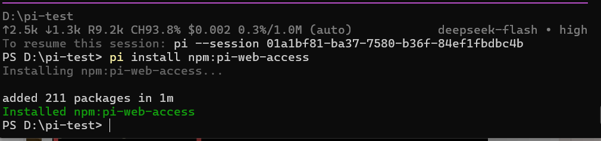
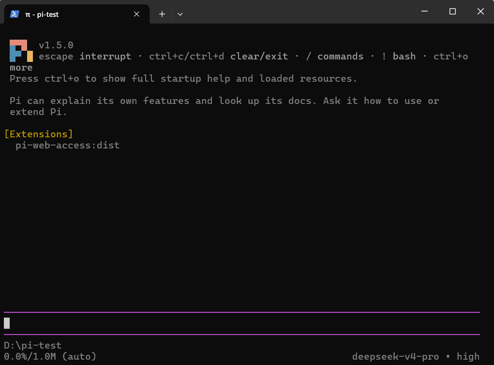
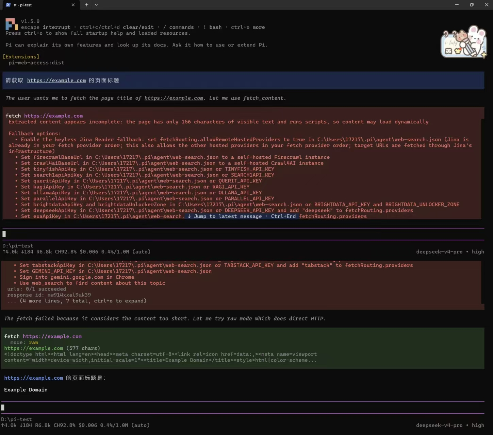

# 实践课1：Pi Agent安装与使用

## 基本信息
- GitHub 登录名：[OdeurCuivre]

## 任务完成情况

### 任务一：本地安装并启动
- **说明**：成功安装了 Pi 客户端，版本 v1.5.0，工作目录为 `D:\pi-test`。
- **截图**：
  

### 任务二：配置模型与会话
- **说明**：使用 DeepSeek API Key 登录，模型为 `deepseek-v4-pro`。完成了一次简单会话。
- **截图**：
  

### 任务三：切换模型与思考级别
- **说明**：
①模型切换：初始默认模型为deepseek-v4-pro，我通过/model命令将其切换为deepseek-flash。第一次测试时因账户欠费报错402，充值后重新测试“请用一句话解释持续集成”，模型正常回复，证明切换成功。
②思考级别切换：切换前底部状态栏显示thinking off，通过/thinking 命令切换到low级别。发送“1+1等于几”测试，模型正常回复，且底部状态栏更新为deepseek-flash • low。
③模型与思考级别的选择考量：deepseek-flash 响应速度快、成本极低，适合处理像本次实验中的简单代码解释和基础问答；而如果面对复杂的源码分析或长文本逻辑推理，我会切换回能力更强的deepseek-v4-pro。同理，思考级别设为low已足够应对此类简单提问；只有遇到复杂的数学推导或算法题时，才会调高思考级别（如high或max），因为级别越高，模型思考时间越长，Token消耗也越大。
- **截图**：
  

### 任务四：引用代码与图片测试
- **说明**：使用 `@` 引用了 `hello.py`；使用插件粘贴了图片并成功让 AI 识别。
- **截图**：
  
  
  

### 任务五：安装并使用插件
- **说明**：
①　本次我选用的插件是 pi-web-access。该插件的作用是为 Pi 提供联网能力，允许 AI 直接抓取网页内容或进行网络搜索，从而获取最新的信息，而不是仅仅依赖模型本身的训练数据。
②　实际调用过程：安装并重新启动 Pi 后，我在启动界面的 [Extensions] 区域确认了该插件已成功加载。随后，我在聊天框输入了提示词：请获取 https://example.com 的页面标题。
③　功能调用结果：AI 成功调用了工具，获取并返回了该网页的标题为 Example Domain，证明联网抓取功能正常。
- **截图**：
  
  
  